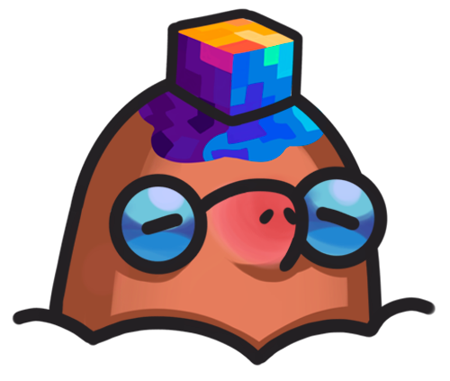
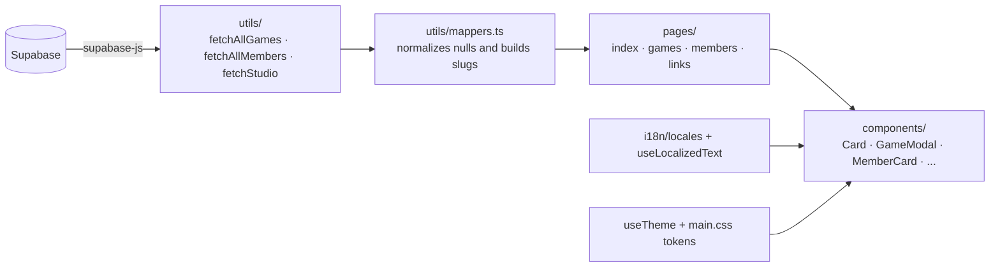
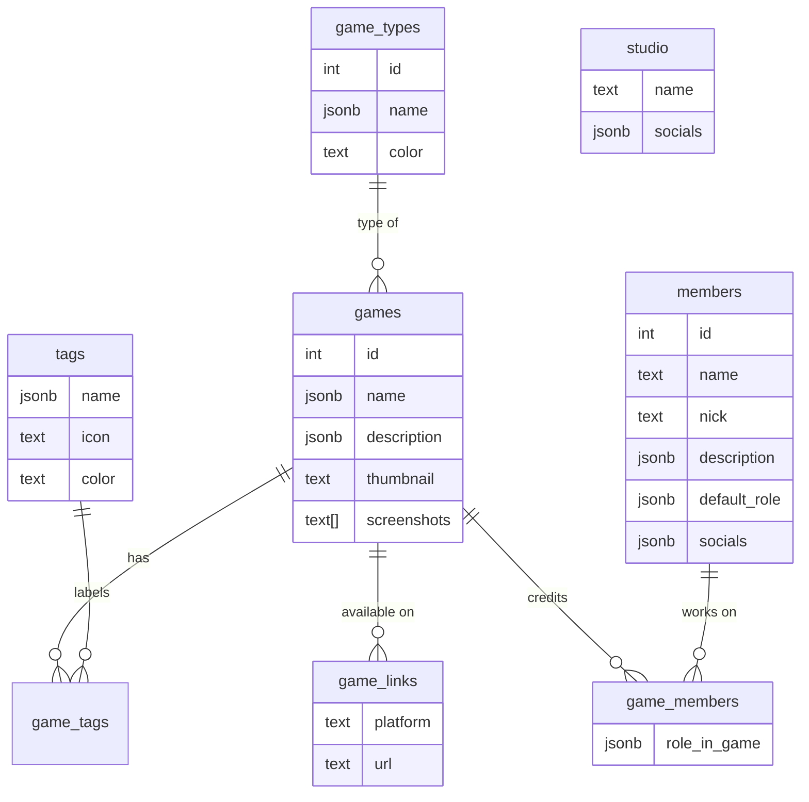

<div align="center">



# Pixel Mole — Website

**Official website and portfolio of Pixel Mole, an indie game studio.**
A game catalog, team profiles and a link page for the studio's socials, all powered by Supabase and available in Portuguese and English.


</div>

---

## Table of contents

- [About](#about)
- [Features](#features)
- [Visual identity](#visual-identity)
- [Tech stack](#tech-stack)
- [Architecture](#architecture)
- [Project structure](#project-structure)
- [Getting started](#getting-started)
- [Database (Supabase)](#database-supabase)
- [Internationalization](#internationalization)
- [Managing content](#managing-content)
- [Deployment](#deployment)

---

## About

The site is Pixel Mole's showcase: it presents the studio, its games and the people behind them. No game or member content is hardcoded. Games, types, tags, team members, credits and social links all come from **Supabase**, so the site grows with the catalog without front-end changes.

## Features

| Route | What it shows |
| --- | --- |
| `/` | Home page: featured game, secondary highlights (*most recent*, *available now*, *in development*), catalog preview, studio stats and team preview |
| `/games` | Full catalog with **search** by name/description, a **type filter** and a **multi-tag filter** |
| `/members` | Grid of every studio member |
| `/members/[nick]` | Individual profile: photo, role, bio, social links, a summary of roles held and the games the person worked on |
| `/links` | A mobile-first, "link in bio" page with the studio's socials and no navbar |
| `/game/rememory` | Dedicated page for REmemory (*still a placeholder*) |

**Behavior details**

- **Game modal:** smaller games, such as game jam entries, open in a modal with a gallery, tags, description, team credits and *"Available on"* buttons for each platform (Steam, itch.io, GitHub, etc.).
- **Dedicated page:** `coming_soon` games link to `/game/<game-name>` instead of opening the modal.
- **Fullscreen gallery:** screenshots open in a lightbox ([Fancybox](https://fancyapps.com/fancybox/)).
- **Cross-linked credits:** the same game ↔ member relationship shows up in each game's credits and in each member's game list, with the specific role held on that game.
- **Light/dark theme:** toggled from the navbar. The choice is saved in `localStorage`; with no saved choice, the site follows the system preference.
- **Bilingual:** Portuguese (default) and English, including text that comes from the database.
- **Resilience:** each home page section is wrapped in its own `<NuxtErrorBoundary>`, and Supabase data is normalized on the way in (`utils/mappers.ts`) so null fields don't break the UI.

## Visual identity

The look is **indie, modern and clean**, with the games front and center. Dark mode is the default.

| Purple | Pink | Blue | Orange | Yellow (accent) | Dark |
| :---: | :---: | :---: | :---: | :---: | :---: |
| `#4D1184` | `#A81E8A` | `#0F6EC1` | `#FD971B` | `#FFD564` | `#272528` |

- **Typography:** *Space Grotesk* for headings and *Inter* for body text (Google Fonts).
- **Design tokens:** brand colors (`--pm-*`) are fixed, while semantic tokens (`surface`, `border`, `content`, `accent`) change between themes. Everything is defined in `assets/css/main.css` and exposed to Tailwind in `tailwind.config.ts`.
- **Details:** animated gradient borders on hover (`GradientBorder`), a purple/blue ambient glow, a subtle reveal on scroll (the `v-reveal` directive, which respects `prefers-reduced-motion`) and list transitions with AutoAnimate.
- **Icons:** [Lucide](https://lucide.dev/) for generic icons. Brand icons (Steam, itch.io, Discord...) are embedded as SVGs in `data/brandIcons.ts`, with no CDN dependency.

## Tech stack

| Technology | Role in the project |
| --- | --- |
| [Nuxt 4](https://nuxt.com/) + [Vue 3](https://vuejs.org/) | Framework, file-based routing and auto-imported components, composables and utils |
| TypeScript | Typing for the data models (`types/`) and logic |
| [Tailwind CSS](https://tailwindcss.com/) (`@nuxtjs/tailwindcss`) | Mobile-first styling on top of CSS design tokens |
| [Supabase](https://supabase.com/) (`@supabase/supabase-js`) | Postgres database holding all site content |
| [`@nuxtjs/i18n`](https://i18n.nuxtjs.org/) | Portuguese/English, with one domain per language |
| [`@formkit/auto-animate`](https://auto-animate.formkit.com/) | Enter/leave animations on grids and filters |
| [`@fancyapps/ui`](https://fancyapps.com/) | Lightbox for the screenshot gallery |
| [`lucide-vue-next`](https://lucide.dev/) | UI icons |

## Architecture

Pages create a Supabase client from the public keys in `runtimeConfig` and fetch data in `onMounted`, showing `<AppLoader />` while loading. Queries live in `utils/`, and every record goes through a *mapper* before it reaches the components.



A few design decisions worth knowing:

- **One source for games:** `fetchAllGames` is used by the home page, `/games` and member profiles, so a game's order and data are the same everywhere.
- **Stable slugs:** types and tags are identified by `slug`, never by the translated name. Until the database has a `slug` column, it's derived from the name's `en` value (`utils/localizedText.ts`).
- **Shared state:** the studio record (`useStudio`) and the theme (`useTheme`) use `useState`, so several parts of a page read the same data without duplicate queries.

## Project structure

```text
website/
├── assets/
│   ├── css/main.css          # Design tokens (colors, themes, radii) and global styles
│   └── img/members/          # Team photos, named by nick (e.g. wanny.jpg)
├── components/               # Auto-imported components
│   ├── Home*.vue             #   Home page sections
│   ├── Card.vue              #   Game card (opens the modal or a dedicated page)
│   ├── GameModal.vue         #   Game details + GameGallery + GameCredits
│   ├── MemberCard.vue        #   Member card
│   └── NavBar.vue / AppFooter.vue / ...
├── composables/              # useTheme, useStudio, useLocalizedText, useCatalogLabel
├── data/
│   ├── games.ts              # LINK_PLATFORMS: platform → label, color and icon
│   └── brandIcons.ts         # Brand SVGs (simple-icons)
├── i18n/locales/             # pt.json and en.json
├── pages/                    # Routes (Nuxt file-based routing)
├── plugins/                  # theme.client.ts (initial theme) and reveal.client.ts (v-reveal)
├── public/                   # favicon, robots.txt and img/logo.png
├── types/                    # Game, Member, Studio, LocalizedText
├── utils/                    # Supabase queries, mappers and helpers
├── nuxt.config.ts
└── tailwind.config.ts
```

## Getting started

### Prerequisites

- **Node.js** `^20.19.0` or `>=22.12.0`, the range required by the project's installed Nuxt 4.3
- **npm**, since the project uses `package-lock.json`
- A **Supabase** project with the tables described [below](#database-supabase)

### 1. Install dependencies

```bash
npm install
```

The `postinstall` script runs `nuxt prepare` automatically and generates the types in `.nuxt/`.

### 2. Set up environment variables

Create a `.env` file in the project root. It's already in `.gitignore`.

```dotenv
# Supabase: project URL and public (anon) key
SUPABASE_URL=https://<your-project>.supabase.co
SUPABASE_KEY=<your-anon-key>

# Domain for each language (@nuxtjs/i18n with differentDomains)
DOMAIN_PT=<portuguese-domain>
DOMAIN_EN=<english-domain>
```

| Variable | Purpose |
| --- | --- |
| `SUPABASE_URL` | Supabase project URL, exposed as `runtimeConfig.public.supabaseUrl` |
| `SUPABASE_KEY` | Supabase **anon/public** key, exposed as `runtimeConfig.public.supabaseKey` |
| `DOMAIN_PT` | Domain that serves the Portuguese site |
| `DOMAIN_EN` | Domain that serves the English site |

> [!WARNING]
> The Supabase keys are sent to the browser, since they live in `runtimeConfig.public`. Use **only the anon key**, never the `service_role` key, and protect your tables with RLS policies.

### 3. Run the project

| Command | What it does |
| --- | --- |
| `npm run dev` | Development server at `http://localhost:3000` |
| `npm run build` | Production build (output in `.output/`) |
| `npm run preview` | Previews the production build locally |
| `npm run generate` | Generates a static version of the site |

> [!NOTE]
> `nuxt.config.ts` enables `usePolling` in Vite's file watcher, which keeps hot reload working in environments where file-change detection is unreliable.

### Tests

The project doesn't have automated tests or lint scripts set up yet.

## Database (Supabase)

The site only reads data. The tables and columns below are the ones the code queries; the database may have others.



- **Multilingual text:** `name`, `description`, `default_role` and `role_in_game` can be plain text or `jsonb` in the form `{ "pt": "...", "en": "..." }`. The `useLocalizedText` composable accepts both and falls back to `pt` when a translation is missing.
- **`studio`** holds a single row with the studio name and the social links used in the footer and on `/links`.
- **Socials and links** (`studio.socials`, `members.socials`, `game_links`) share the `{ platform, url }` shape. The `platform` value (e.g. `steam`, `itch.io`, `instagram`, `website`) picks the icon and color from the `LINK_PLATFORMS` map in `data/games.ts`.
- **RLS:** every table needs a `SELECT` policy for the `anon` role. New Supabase tables start with RLS enabled and no policies, which makes queries come back empty. Example:

```sql
CREATE POLICY "Public read" ON public.studio FOR SELECT USING (true);
```

## Internationalization

- Languages: **Portuguese (`pt`, default)** and **English (`en`)**, configured in `nuxt.config.ts`.
- `differentDomains` strategy: each language is served on its own domain (`DOMAIN_PT` / `DOMAIN_EN`), and the navbar's language picker redirects to the matching domain.
- UI strings live in `i18n/locales/*.json`. Type and tag names from the database can be translated under `catalog.types.*` / `catalog.tags.*`. Without a translation, the slug is formatted automatically (`game_jam` becomes "Game jam").

## Managing content

| To... | Do this |
| --- | --- |
| Add a game, tag, type or member | Insert the records in Supabase. The site updates with no code changes |
| Add a member's photo | Put the image at `assets/img/members/<nick>.<ext>` (png, jpg, jpeg, webp, avif or gif). Without a photo, the avatar shows the member's initials |
| Support a new link platform | Add the key to `LINK_PLATFORMS` (`data/games.ts`) and, if it has a brand icon, the SVG to `data/brandIcons.ts` |
| Translate a new tag/type | Add the key under `catalog.tags` / `catalog.types` in both files in `i18n/locales/` |

## Deployment

The repository has no hosting-specific configuration. To publish:

1. Run `npm run build`, which produces the Nitro server in `.output/`, or `npm run generate` for a static version.
2. Set the four environment variables on your hosting platform.
3. Point the domains set in `DOMAIN_PT` and `DOMAIN_EN` at the same application.

See the [Nuxt deployment guide](https://nuxt.com/docs/getting-started/deployment) for provider-specific instructions.

---

<div align="center">
  <sub>Made with 💛 by <b>Pixel Mole</b></sub>
</div>
